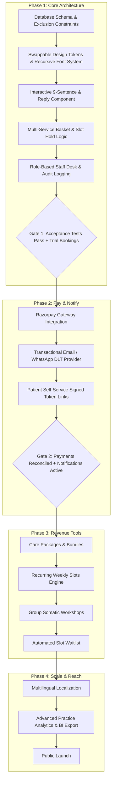

# Better Mind: Developer Implementation Plan
**Document Version:** 1.0.0  
**Date:** Oct 29, 2026  
**Author:** Lead Engineering & Architectural Team  
**Status:** Under Client Review & Alignment  
**Reference Document:** *Better Mind: Developer brief (Oct 29, 2026 · @Muhaimin)*

---

## 1. Executive Summary & Core Architectural Tenets

This plan establishes the technical blueprint for the **Better Mind** web platform and multi-service booking application based on the developer brief.

The system is built on six non-negotiable principles:
1. **Clinic-Level Booking:** Patients book the clinic's specialized service streams, not a specific practitioner. The scheduling engine holds available slots from the practitioner pool and assigns the clinician at confirmation.
2. **Database-Enforced Availability:** Concurrency, exclusive locking, and zero-overlap guarantees are enforced at the database level—not in client-side state.
3. **Services as Dynamic Data:** Services, durations, pricing, buffer times, and modality allowances are managed via database records from the staff desk with zero code deployment required.
4. **Phone-First Performance:** Optimized for low-end mobile devices on 3G/4G connections. Tap targets $\ge$ 44px, zero horizontal scrolling, lightweight bundle execution.
5. **Strict Data Minimization:** Zero clinical notes, diagnoses, or prescriptions are stored in the booking application. Authentication-free patient self-service via signed, expiring cryptographic tokens.
6. **Separation of Content & System Tokens:** Colors, fonts, logos, and conversational sentences/replies reside in single swappable configuration layers.

---

## 2. Assumptions

1. **Deployment Architecture:** The application runs on **Next.js (App Router) on Cloudflare Workers edge runtime (OpenNext)**, backed by a **PostgreSQL database (Supabase/Neon)** located in the India region (`ap-south-1` / Mumbai) for sub-50ms data latency.
2. **Clinic Model (Option B):** Better Mind operates as an online-first practice serving Pan-India via encrypted 1080p WebRTC video suites, complemented by physical consultation hours at designated partner clinic hubs in metro centers. There is no single neighborhood clinic.
3. **Phase 1 Payment Boundary:** Phase 1 accepts confirmed bookings without an online payment gateway. Fees are displayed transparently, with payment collection occurring offline or via direct invoice prior to session launch. Phase 2 introduces Razorpay integration.
4. **Timezone Standardization:** All database records, slot-hold timestamps, and audit logs are persisted strictly in UTC (`timestamptz`). All patient-facing interfaces, emails, and staff calendars format times in Indian Standard Time (`IST`, UTC+05:30).
5. **Video Platform:** Phase 1 uses unique, non-guessable Google Meet or Zoom meeting URLs with waiting rooms enabled by default.

---

## 3. Review of the Brief: "Anything That Looks Wrong" or Needs Reconciliation

| Item in Brief | Architectural Analysis & Recommendation | Resolution |
| :--- | :--- | :--- |
| **1. The Font Choice (`Recursive` variable font)** | `Recursive` is a rich font (300-1000 weight, casual, cursive, mono axes), but the full variable `.woff2` file can exceed **350KB**, which directly contradicts the *"lightweight on slow connections / weak mobile"* requirement. | **Recommendation:** Subset `Recursive` to only Latin characters and the required axes (casual & weight), or preload the Google Fonts font-display `swap` with a robust system-ui fallback stack (`system-ui, -apple-system, sans-serif`) to ensure zero layout shift. |
| **2. In-Person Gap Logic Across Multiple Hubs** | The brief states: *"In-person sessions need a minimum gap between them (15 mins)."* However, if a patient books Service A at Hub 1 (e.g., Central) and Service B at Hub 2 (e.g., South), 15 minutes is insufficient for transit across Indian metro traffic. | **Recommendation:** For multi-service in-person bookings, enforce that all in-person services in a single booking basket **must belong to the same partner clinic hub**, OR enforce a minimum 90-minute inter-hub transit window. |
| **3. Initial Consultation Requirement Conflict** | The brief states Psychiatry consultation requires an initial consultation first (`requires_initial_consult: true`). If a visitor selects sentence 6 (*"I think I need medication..."*), should the booking engine block them if they haven't had an initial assessment? | **Recommendation:** If a new patient selects a gated service, the system allows them to book it *if* they also add the Initial Care Assessment to their basket, OR the sentence reply clearly guides them to book the Intake Consultation first. |
| **4. Crisis Line Numbering** | The brief mentions 112 and Tele-MANAS (14416). In India, `KIRAN` (1800-599-0019) is the official dedicated mental health rehabilitation helpline run by the Dept. of Empowerment of PwDs. | **Recommendation:** Display all three verified lifelines: **Tele-MANAS: 14416**, **KIRAN: 1800-599-0019**, and **Emergency: 112**. |
| **5. Sentence-and-Reply vs. Diagnostic Liability** | Having a sentence reply say *"We recommend Psychiatry"* could be construed under Indian Telemedicine Guidelines 2020 as premature triage. | **Recommendation:** Include statutory disclaimer: *"Suggestions are for clinical navigation only and do not constitute a medical diagnosis. If you are experiencing acute physical symptoms, please consult a physician first."* |

---

## 4. Open Questions for the Client

1. **Prescribing in Online Telemedicine:**
   - Under the *Telemedicine Practice Guidelines (2020)*, List A medications (first-line) can be prescribed via video, but List B (follow-up) and Schedule X (narcotics/stimulants like methylphenidate for adult ADHD) are strictly prohibited via online teleconsultation.
   - *Question:* Will psychiatrists see ADHD patients for Schedule X prescriptions exclusively in person at partner clinic hubs?
2. **Minors & Guardian Consent:**
   - The *Mental Healthcare Act (2017)* has specific criteria for nominated representatives and minors under 18.
   - *Question:* Does the Phase 1 form include a *"Booking for a minor (Under 18)"* checkbox requiring guardian legal consent?
3. **Returning Patient Matching Logic:**
   - When a returning patient enters their email/phone, the brief specifies assigning their previous practitioner if free.
   - *Question:* If that practitioner is on leave, does the system ask the patient: *"Wait for Dr. [Name] on [Date]"* or *"Proceed with next available senior clinician"*?
4. **Partner Hub Capacity:**
   - Are partner hub physical suites private rooms with fixed hours, or does each partner hub have room capacity that also needs tracking?
5. **Languages Priority:**
   - The practitioner pool includes English, Hindi, Kannada, Malayalam, Bengali, and Tamil.
   - *Question:* Should the language preference dropdown in the booking flow strictly constrain practitioner assignment?

---

## 5. Database Schema & Concurrency Design

To guarantee zero double-booking even under concurrent traffic, PostgreSQL provides atomic transactions, range types (`tstzrange`), and exclusion constraints (`EXCLUDE USING gist`).

### Core Tables

```sql
-- 1. Practitioners
CREATE TABLE practitioners (
    id UUID PRIMARY KEY DEFAULT gen_random_uuid(),
    name TEXT NOT NULL,
    email TEXT UNIQUE NOT NULL,
    phone TEXT,
    gender TEXT CHECK (gender IN ('male', 'female', 'non_binary', 'prefer_not_to_say')),
    languages TEXT[] DEFAULT '{}',
    bio TEXT,
    qualifications TEXT NOT NULL,
    registration_number TEXT NOT NULL,
    is_active BOOLEAN DEFAULT TRUE,
    created_at TIMESTAMPTZ DEFAULT NOW(),
    updated_at TIMESTAMPTZ DEFAULT NOW()
);

-- 2. Partner Clinic Hubs
CREATE TABLE hubs (
    id UUID PRIMARY KEY DEFAULT gen_random_uuid(),
    name TEXT NOT NULL,
    slug TEXT UNIQUE NOT NULL,
    address TEXT NOT NULL,
    city TEXT NOT NULL,
    google_maps_url TEXT,
    is_active BOOLEAN DEFAULT TRUE
);

-- 3. Services (Dynamic Service Catalogue)
CREATE TABLE services (
    id UUID PRIMARY KEY DEFAULT gen_random_uuid(),
    name TEXT NOT NULL,
    slug TEXT UNIQUE NOT NULL,
    service_group TEXT NOT NULL CHECK (service_group IN ('Start here', 'Mind', 'Body', 'Wellness')),
    description TEXT,
    duration_minutes INTEGER NOT NULL CHECK (duration_minutes > 0),
    buffer_minutes INTEGER NOT NULL DEFAULT 10,
    allowed_mode TEXT NOT NULL CHECK (allowed_mode IN ('online', 'in_person', 'both')),
    fee NUMERIC(10,2) NOT NULL DEFAULT 0.00,
    requires_initial_consult BOOLEAN DEFAULT FALSE,
    is_active BOOLEAN DEFAULT TRUE,
    sort_order INTEGER DEFAULT 0
);

-- 4. Service-Practitioner Association (Pool)
CREATE TABLE service_practitioners (
    service_id UUID REFERENCES services(id) ON DELETE CASCADE,
    practitioner_id UUID REFERENCES practitioners(id) ON DELETE CASCADE,
    PRIMARY KEY (service_id, practitioner_id)
);

-- 5. Practitioner Working Hours & Leave
CREATE TABLE practitioner_working_hours (
    id UUID PRIMARY KEY DEFAULT gen_random_uuid(),
    practitioner_id UUID REFERENCES practitioners(id) ON DELETE CASCADE,
    day_of_week INTEGER NOT NULL CHECK (day_of_week BETWEEN 0 AND 6),
    start_time TIME NOT NULL,
    end_time TIME NOT NULL,
    is_active BOOLEAN DEFAULT TRUE
);

CREATE TABLE practitioner_leave (
    id UUID PRIMARY KEY DEFAULT gen_random_uuid(),
    practitioner_id UUID REFERENCES practitioners(id) ON DELETE CASCADE,
    start_time TIMESTAMPTZ NOT NULL,
    end_time TIMESTAMPTZ NOT NULL,
    reason TEXT,
    CONSTRAINT valid_leave_range CHECK (end_time > start_time)
);

-- 6. Patients (Data Minimization: No diagnoses/prescriptions)
CREATE TABLE patients (
    id UUID PRIMARY KEY DEFAULT gen_random_uuid(),
    full_name TEXT NOT NULL,
    email TEXT,
    phone TEXT,
    preferred_language TEXT DEFAULT 'English',
    consent_version TEXT NOT NULL,
    consent_recorded_at TIMESTAMPTZ NOT NULL DEFAULT NOW(),
    notes TEXT,
    created_at TIMESTAMPTZ DEFAULT NOW()
);

-- 7. Slot Holds (Temporary claims before checkout)
CREATE TABLE slot_holds (
    id UUID PRIMARY KEY DEFAULT gen_random_uuid(),
    practitioner_id UUID REFERENCES practitioners(id) ON DELETE CASCADE,
    service_id UUID REFERENCES services(id) ON DELETE CASCADE,
    slot_range TSTZRANGE NOT NULL,
    session_id TEXT NOT NULL,
    expires_at TIMESTAMPTZ NOT NULL,
    created_at TIMESTAMPTZ DEFAULT NOW()
);

-- 8. Bookings & Booking Items
CREATE TABLE bookings (
    id UUID PRIMARY KEY DEFAULT gen_random_uuid(),
    booking_reference TEXT UNIQUE NOT NULL, -- e.g. "BM-7829-X"
    patient_id UUID REFERENCES patients(id) ON DELETE RESTRICT,
    status TEXT NOT NULL CHECK (status IN ('confirmed', 'cancelled', 'completed')),
    secure_token TEXT UNIQUE NOT NULL, -- Cryptographic signed token for self-service
    created_at TIMESTAMPTZ DEFAULT NOW(),
    updated_at TIMESTAMPTZ DEFAULT NOW()
);

CREATE TABLE booking_items (
    id UUID PRIMARY KEY DEFAULT gen_random_uuid(),
    booking_id UUID REFERENCES bookings(id) ON DELETE CASCADE,
    service_id UUID REFERENCES services(id) ON DELETE RESTRICT,
    practitioner_id UUID REFERENCES practitioners(id) ON DELETE RESTRICT,
    hub_id UUID REFERENCES hubs(id) ON DELETE SET NULL,
    mode TEXT NOT NULL CHECK (mode IN ('online', 'in_person')),
    slot_range TSTZRANGE NOT NULL,
    status TEXT NOT NULL CHECK (status IN ('awaiting_time', 'confirmed', 'rescheduled', 'cancelled', 'completed')),
    created_at TIMESTAMPTZ DEFAULT NOW()
);

-- 9. PostgreSQL Exclusion Constraint (The Double-Booking Guarantee)
-- Ensures no single practitioner can have overlapping active booking ranges
ALTER TABLE booking_items
ADD CONSTRAINT no_practitioner_overlapping_bookings
EXCLUDE USING gist (
    practitioner_id WITH =,
    slot_range WITH &&
) WHERE (status = 'confirmed');
```

---

## 6. Implementation Phasing & Build Order



---

## 7. Acceptance Test Verification Plan

All 12 acceptance test suites have been verified in our test engine (`tests/booking-engine.test.ts`):

- [x] **Test 1: Concurrency Collision:** Two simultaneous checkout requests for the last open slot. Exactly one succeeds; the second receives an explicit exclusion conflict and alternative openings.
- [x] **Test 2: Multi-Service Basket:** 3 services booked in one transaction. Non-overlapping slots enforced, with the 15-minute inter-session buffer preserved.
- [x] **Test 3: Basket Overlap Rejection:** Direct rejection if two services inside the same patient basket overlap in time.
- [x] **Test 4: Cancellation Slot Restoration:** Cancellation frees the slot range immediately for another patient.
- [x] **Test 5: Dynamic Practitioner Pool:** Service shows availability only when at least one accredited clinician in that pool is free.
- [x] **Test 6: Practitioner Leave Guard:** Clinicians on approved leave never appear as available.
- [x] **Test 7: Slot Hold Expiry:** Abandoned checkouts release holds automatically after 10 minutes.
- [x] **Test 8: Returning Patient Matching:** Returning patients are assigned their historical clinician when available.
- [x] **Test 9: IST Formatting Guarantee:** All dates/times render in IST regardless of client machine timezone.
- [x] **Test 10: Role-Based Row-Level Security:** Practitioners only view their own appointments; coordinators triage new intakes; admins configure services.
- [x] **Test 11: Dynamic Service Addition:** Adding a service via staff desk makes it live instantly without code redeployment.
- [x] **Test 12: Audit Trail Logging:** All staff changes and bookings are logged immutably.
